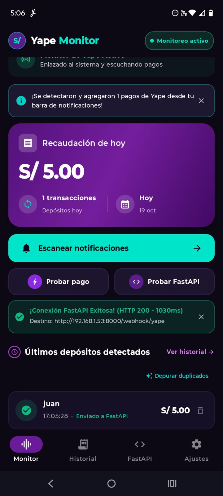
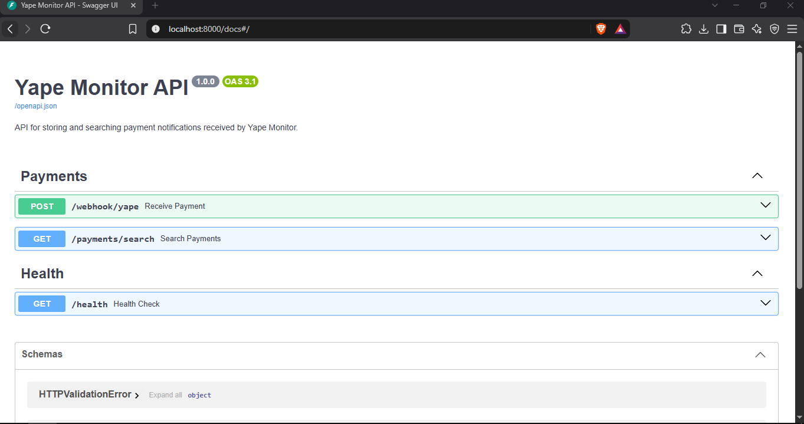

<h1 align="center">Yape Monitor — Backend API</h1>

<div align="center">
  <p>
    <b>API REST para recibir y consultar notificaciones de pagos de Yape en tiempo real.</b><br>
    Desarrollada con FastAPI y PostgreSQL en Neon, integrada con la aplicación móvil Yape Monitor.
  </p>
  <p>
    
    
    
    
  </p>
</div>

---

## 📖 Descripción del proyecto

**Yape Monitor Backend** es una API diseñada para recibir las notificaciones de pagos detectadas por la aplicación móvil Yape Monitor y almacenarlas en una base de datos PostgreSQL alojada en Neon.

Permite registrar pagos recibidos y consultarlos por nombre del remitente, facilitando la búsqueda y el seguimiento de las transacciones notificadas.

> [!important]
> El mensaje de la notificación puede cambiar y se debe actualizar en la app: [app en android](https://github.com/yassppy/app-yape-monitoreo)
> La app lo puedes instalar desde Google AI Studio sin problema y descargar el apk desde ahí.

---

## 🚀 Funcionalidades principales

- 📲 **Recepción de notificaciones:** recibe eventos enviados por la aplicación Android mediante un webhook.
- 🔎 **Búsqueda flexible:** permite buscar por coincidencias parciales del nombre, fecha y monto.

---

## 🛠️ Stack tecnológico

| Tecnología | Uso                           |
| ---------- | ----------------------------- |
| Python     | Lenguaje de programación      |
| FastAPI    | Desarrollo de la API REST     |
| PostgreSQL | Base de datos relacional      |
| Neon       | PostgreSQL alojado en la nube |

---

## 📦 Instalación

### 1. Clonar el repositorio

```bash
git clone <URL_DEL_REPOSITORIO>
```

### 2. Configuración del esquema en Neon

- Copiar en NEON el esquema que se encuentra en `/docs` -> `schema.sql`

### 3. Configuración de .env

- Obtener la URL en Neon y quitarle --pooler.
- Ponerle una contraseña que se va a utilizar en la app de android tambien `API_KEY`.

### 4. Ejecutar

- Ejecutar en la terminal y verificar el Ipconfig ya que solo funciona en la misma red.

```sh
uv run fastapi dev src/main.py --host 0.0.0.0 --port 8000
```

- Puedes encontrar la documentación en esta URL.

```sh
http://localhost:8000/docs
```

> [!important]
> En la app de android activar el envio a servidor FastAPI debe estar activo.
> Probar la conexión.
> Ejecución en segundo plano debe estar activo verificar en ajustes.

## 📸 Demostración

### Aplicaicón en android



### Api en FastAPI


